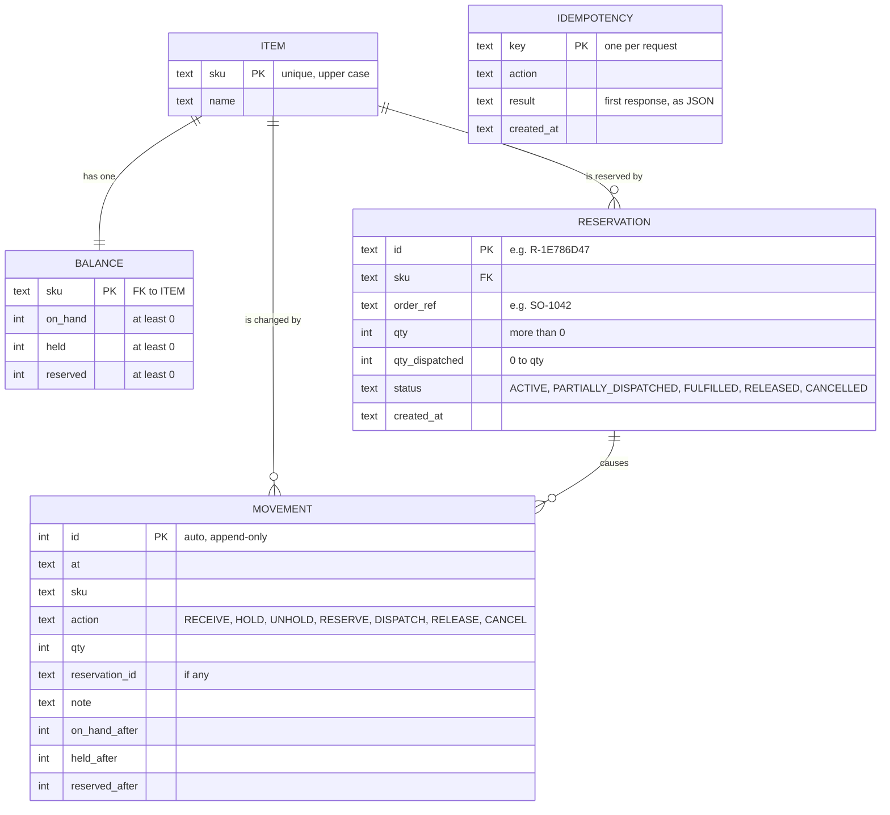
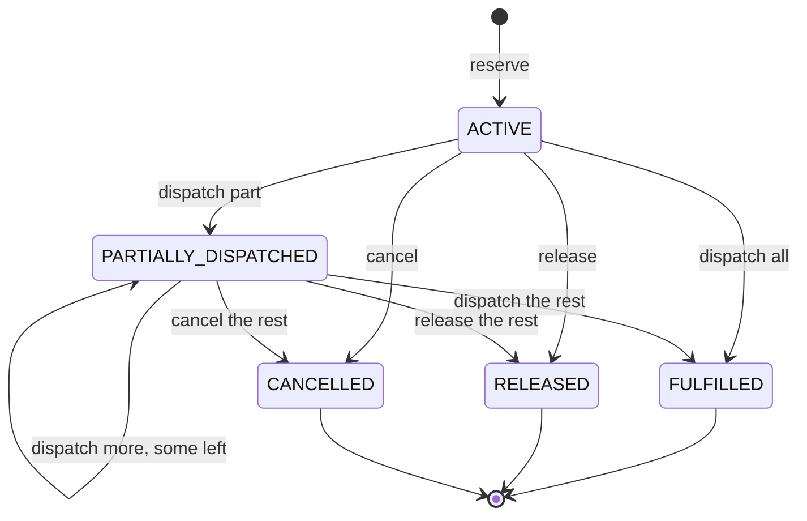
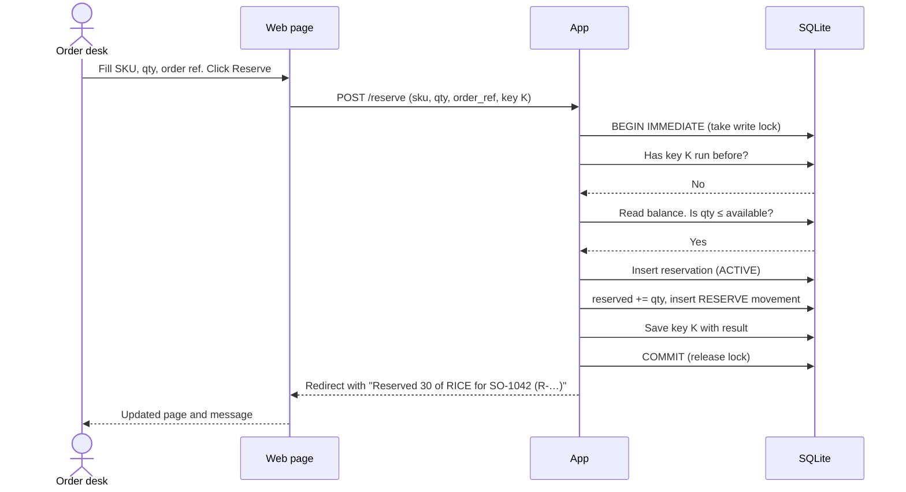
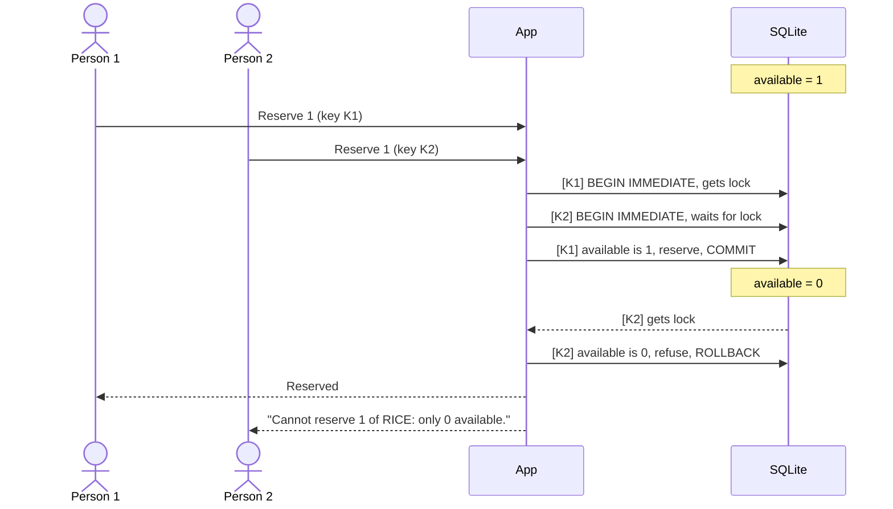
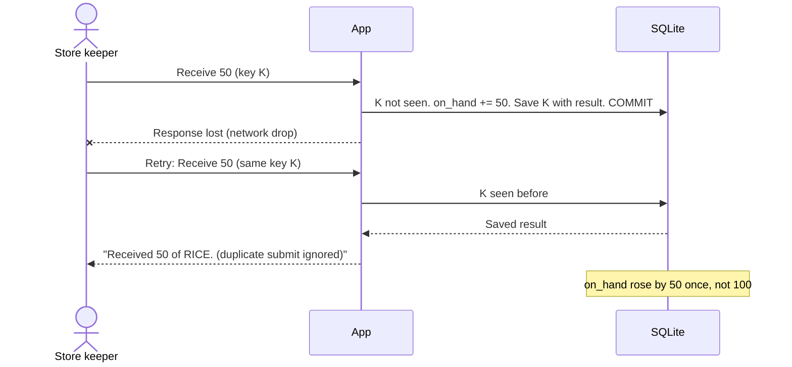

# Design: Stock Tracker

How the data is stored, how a reservation moves through its life, and what happens step by step when things go wrong. The rules referenced here (BR-xx) are in [PRD.md](PRD.md).

GitHub draws the diagrams below automatically (they are written in Mermaid).

## 1. Data model

### Source of truth

| Number | Source of truth | Check |
|---|---|---|
| On hand, held, reserved | `BALANCE` row | Rebuilt from `MOVEMENT` on every page load (REQ-12) |
| Available | Calculated, never stored: `on_hand − held − reserved` | Database constraint `on_hand − held − reserved ≥ 0` (BR-02) |
| Reservation progress | `RESERVATION.qty_dispatched` and `status` | Constraint `qty_dispatched ≤ qty` |
| Has this request run already? | `IDEMPOTENCY` row | Primary key on `key` |

**Why store balances and keep a ledger?** Rebuilding balances from the ledger on every read is slow once history grows. Storing only balances loses the *why*. Doing both, in one transaction (BR-07), gives fast reads and a full history, and the ledger check catches it if they ever drift apart.

**Why is available never stored?** A stored copy could drift from the three numbers it depends on. Calculating it means it is always right.

## 2. Reservation status flow

Closed statuses (FULFILLED, RELEASED, CANCELLED) accept no further actions (BR-06).

### What each action does to the balance

| Action | on_hand | held | reserved | available |
|---|:-:|:-:|:-:|:-:|
| Receive q | +q | | | +q |
| Hold q | | +q | | −q |
| Unhold q | | −q | | +q |
| Reserve q | | | +q | −q |
| Dispatch q | −q | | −q | 0 |
| Release / cancel (r left) | | | −r | +r |

Dispatch doesn't change available: the units were already promised, and now they have left.

### Worked example

| Step | on_hand | held | reserved | available |
|---|:-:|:-:|:-:|:-:|
| Receive 100 | 100 | 0 | 0 | 100 |
| Hold 10 (damaged) | 100 | 10 | 0 | 90 |
| Reserve 30 for SO-1042 | 100 | 10 | 30 | 60 |
| Dispatch 20 on SO-1042 | 80 | 10 | 10 | 60 |
| Cancel SO-1042 (10 left) | 80 | 10 | 0 | 70 |

## 3. Sequence flows

### 3.1 Reserve (normal path)

### 3.2 Two people reserve the last units at the same time

Without the lock, both would read "available = 1" before either saved, and both would succeed. That's the over-promise the app exists to prevent (BR-10).

### 3.3 Double-click or network retry

Each form gets a new key when the page loads, so the same form sent twice carries the same key. A new action after the page reloads gets a new key.

### 3.4 Failure partway through

If anything fails after `BEGIN IMMEDIATE` (a rule check, a database constraint, a crash), the whole transaction is rolled back. The balance, movement, reservation and request key are saved together or not at all (BR-07). A failed request doesn't save its key, so retrying it re-checks against current stock.

## 4. Technology choices

| Choice | Why | Trade-off |
|---|---|---|
| Python standard library | Runs on any Mac or Linux machine with no installs | No framework conveniences (forms, templates) |
| SQLite | Real transactions and constraints in a single file | One writer at a time. Fine for one site, but many sites would need Postgres with row-level locks |
| Server-rendered HTML | One page, no JavaScript build step | Full page reload on every action |
| Post/Redirect/Get | A browser refresh doesn't resubmit the form | One extra request per action |
